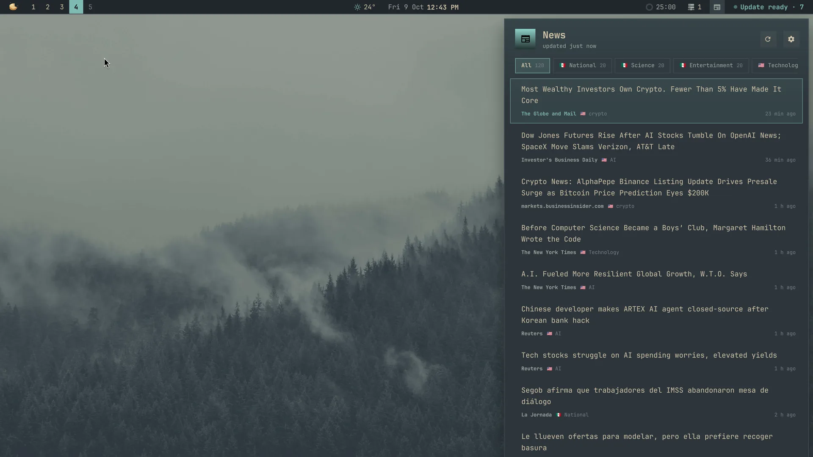
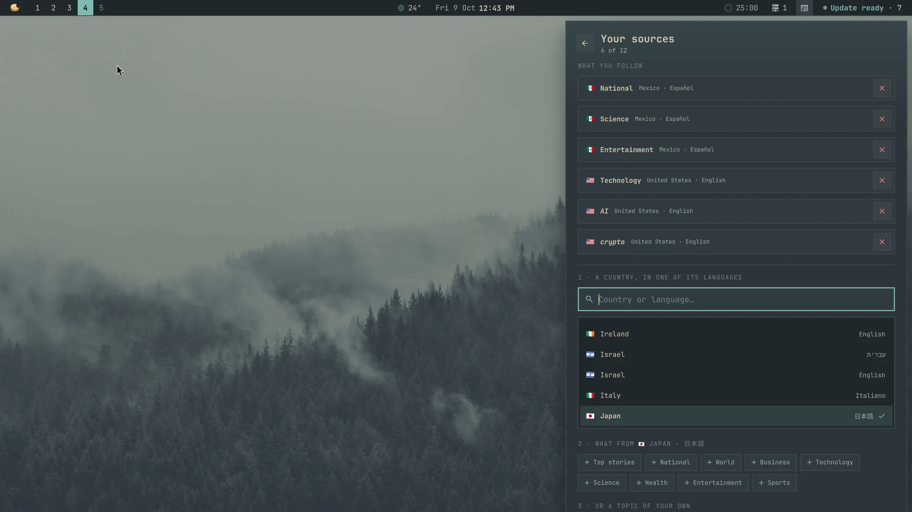
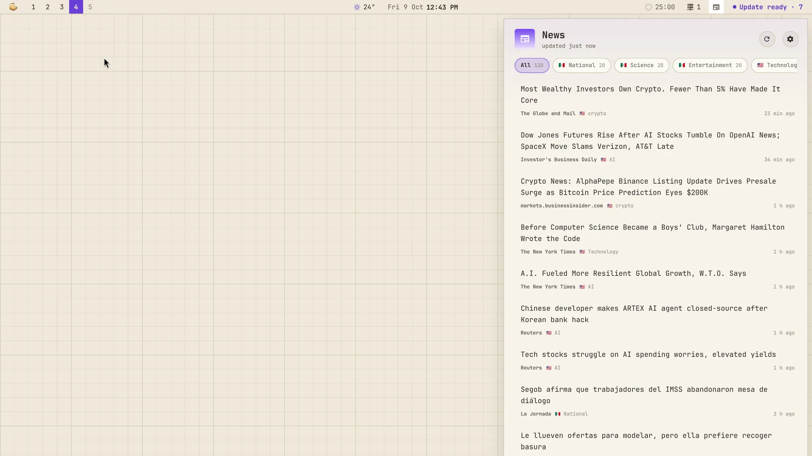

# News

A plugin for [Mazapan](https://mazapan.dev), listed in its [plugin registry](https://mazapan.dev/plugins/news/).

The news from where you're from and where you live, in the languages you
read. From Mexico and living in Japan: Mexico's national news and science
in Spanish, Japan's front page in Japanese, and AI and crypto from the US
in English, all in one place. Quiet until you want it: an icon in the bar,
a panel made for reading when you open it, and nothing else. No
notifications, nothing in the Control Center.



- **Editions by country and language**: every edition Google News has,
  80-odd, each a country in one of its languages (Mexico · Español, Canada
  · English or Français, India in seven languages, Japan · 日本語). A
  country in a language Google doesn't have (Japan in English) isn't one,
  so it isn't offered.
- **Its sections**, in that edition's language: Top stories, National,
  World, Business, Technology, Science, Health, Entertainment, Sports.
- **Your own topics**: any words, looked for in that edition over the last
  two days (AI, bitcoin, video games, inteligencia artificial…), with a
  few suggested in its language.
- **Up to 12 sources**, from as many countries as you like. Your country's
  front page until you pick yours (from the desktop's language: `es_MX`
  is Mexico in Spanish).
- **Made for reading**: each headline whole, in the reading font, never
  cut to one line; its newspaper and how long ago below it. What came since
  you last looked goes first, marked. Your sources are filters on top:
  all of them together, or one. A click, or Enter, opens it in the browser.
- **In the bar**: only its icon, with a dot when there's news since you
  last looked. A right click looks for news now.
- **It keeps what it got**: the panel opens at once with what came last,
  also without internet; it looks again every 30 minutes, and as soon as
  the internet is back. A source that can't be reached keeps its last
  headlines, and says so.

`SUPER + ALT + E` opens it (also "News" in the palette). ↑ ↓ (or j k)
move, ← → (or Tab) change the source, Enter opens the headline, Ctrl+R
looks for news now, Ctrl+S opens your sources, Esc closes.



Your sources: ⚙ in the panel (or Ctrl+S). Type a country or a language,
pick it, then tap what you want from it: each section is added with a tap
and taken away with another; a topic of your own is typed and added with
Enter. ✕ takes a source away.



## Settings

| Setting | Default | |
|---|---|---|
| `key` | `SUPER + ALT + E` | Opens the news |
| `bar` | on | Its icon in the bar |
| `dot` | on | A dot on the icon when there's news since you last looked |
| `every` | 30 | Minutes between looks for news (10 to 240) |
| `per_source` | 20 | Headlines from each source (5 to 50) |

Your sources aren't settings: they're picked in the panel.

## What it reaches and why

- **news.google.com**, and nothing else: one RSS feed per source, asked
  over https only (a redirect elsewhere is refused), for 10 seconds and
  1 MB at most, every 30 minutes and when you ask. What's sent is what any
  feed reader sends: the edition, the section or your words. No account,
  no identifier, no cookies.
- **What it reads from a feed**: each headline's title, newspaper, link and
  time. A feed with a DTD is refused (no entities, nothing loaded from
  elsewhere); links that aren't https are left out.
- **What it opens**: the headline's link, in your browser, with `xdg-open`
  (Google News' link, which takes you to the newspaper's page).
- **Files it keeps**: `~/.local/state/mazapan/news/` (your sources, the
  last headlines, when you last looked).
- **Files it writes**: its part of the shell (`components/news/`, the
  bar's icon, the panel), its key in Hyprland, its helper
  (`~/.local/share/mazapan/bin/news`, `python3 -I`, only Python's own
  library), and its settings, read as they change.

From a terminal:

```sh
python3 -I ~/.local/share/mazapan/bin/news show        # what came last, as JSON
python3 -I ~/.local/share/mazapan/bin/news fetch       # look for news now
python3 -I ~/.local/share/mazapan/bin/news sources     # your sources
python3 -I ~/.local/share/mazapan/bin/news editions    # every edition there is
```

## Install

In Mazapan, the Plugins panel (`SUPER + SHIFT + P`) lists it under the
community's: its page shows what it can do before you install it. Or:

```sh
mazapan plugins add news
mazapan apply
```

Updates come through the registry: `mazapan plugins update news`, or the
Updates panel, asking again only for anything new it would be able to do.

## Develop

```sh
git clone https://github.com/rick-dev-creator/mazapan-news
mazapan plugins dev mazapan-news     # applied again on every save
mazapan plugins check mazapan-news   # every theme, every language, before a release
python3 -m unittest discover -s mazapan-news/tests   # the helper's tests
```

A release is a tag, `vX.Y.Z`, the same as `version` in plugin.toml; the
registry lists it once it passes its checks.

The idea comes from Omarchy's [Omanews](https://github.com/brianblakely/omanews)
(a headline ticker for the bar); the code is this plugin's own.

## License

MIT
